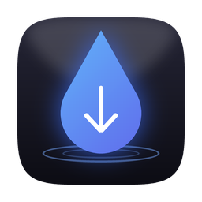

<p align="center"></p>

<h1 align="center">DarkDrop</h1>

Aynı ağdaki iki bilgisayar arasında **pano** ve **dosya** paylaşımı. Windows ve macOS.

- **Tek dosya, kurulum yok.** Windows'ta `DarkDrop.exe`, Mac'te `DarkDrop.app`. Masaüstüne at, çift tıkla.
- **Uçtan uca şifreli.** İlk bağlantıda iki ekranda aynı 6 haneli kod çıkar; ikisinde de onaylarsın.
- **İnternete hiç bağlanmaz.** Hesap yok, bulut yok, telemetri yok, güncelleme kontrolü yok.
- **Yönetici izni istemez.** Sistem ayarlarına, güvenlik duvarına, kullanıcı hesaplarına dokunmaz.
- Her şey kapalı başlar; pano paylaşımını sen açarsın. Gelen her dosya senin onayını bekler.

## İndir

[Releases](../../releases) sayfasından ya da en son derlemeyi [Actions](../../actions) sekmesinden indir:

| Sistem | Dosya | İlk açılış |
|---|---|---|
| Windows 10/11 | `DarkDrop.exe` | İmzasız olduğu için SmartScreen çıkarsa **Ek bilgi → Yine de çalıştır**. Güvenlik Duvarı sorarsa **Özel ağlar**'a izin ver. |
| macOS 11+ (Intel ve Apple Silicon) | `DarkDrop-macOS.zip` → `DarkDrop.app` | Zip'i aç, uygulamaya **sağ tık → Aç**. "Yerel ağ" izni sorarsa izin ver. |

## Kullanım

1. İki bilgisayarda da DarkDrop'u aç. **Cihazlar** bölümünde diğerini görürsün (görünmezse IP adresini yaz).
2. **Bağlan**'a bas. İki ekranda çıkan kod aynıysa iki tarafta da **Aynı, eşleştir**. Bu bir kereliktir; sonra otomatik bağlanırlar.
3. **Paylaşım** → Pano'yu aç: bir tarafta kopyaladığın metin diğerinde yapıştırılır.
4. **Dosyalar** → sürükle-bırak ya da tıkla. Gelenler varsayılan olarak `İndirilenler/DarkDrop` klasörüne kaydedilir.

## Fare ve klavye paylaşımı (Input Leap ile)

DarkDrop fare/klavye paylaşmaz. Bunun için olgun, açık kaynak bir araç olan **Input Leap**'i yanında kullan:

1. [Input Leap sürümleri](https://github.com/input-leap/input-leap/releases) sayfasından iki bilgisayara da indir.
2. Fare ve klavyesini kullanacağın bilgisayarda **Server**'ı seç, ekranları sürükleyerek yan yana diz.
3. Diğer bilgisayarda **Client**'ı seç ve server'ın IP adresini gir (DarkDrop'un Cihazlar listesinde görünür).
4. macOS'ta Input Leap için **Sistem Ayarları → Gizlilik ve Güvenlik → Erişilebilirlik** izni gerekir.

## Güvenlik tasarımı

| Konu | Nasıl |
|---|---|
| Kimlik | Her cihazın kalıcı bir Ed25519 anahtarı vardır (kullanıcı klasöründe). |
| Eşleştirme | Geçici X25519 anahtar değişimi ve iki tarafın imzası. 6 haneli kod oturum transkriptinden türetilir; araya biri girerse kodlar farklı çıkar. İki taraf onaylamadan hiçbir özellik çalışmaz. |
| Şifreleme | AES-256-GCM, her yön için ayrı anahtar ve sayaç. Değiştirilmiş, tekrar oynatılmış ya da sırası bozuk paket bağlantıyı keser. |
| Dosyalar | Onaysız yazılmaz. Ad temizlenir (klasör dışına çıkamaz), var olanın üzerine yazılmaz. Boyut veya SHA-256 tutmazsa silinir. |
| Ağ | TCP 47910 (bağlantı), UDP 47911 (yalnızca yerel ağda cihaz bulma). |

Veriler: Windows `%APPDATA%\DarkDrop`, macOS `~/Library/Application Support/DarkDrop` (ayarlar, cihaz kimliği, eşleşmiş cihazlar).

## Kaynaktan derleme

```
cargo build --release          # target/release/darkdrop(.exe)
cargo test                     # birim + Node referansıyla birlikte çalışma testleri
cargo run -- --demo            # arayüzü örnek veriyle aç
```

`main`'e her gönderimde GitHub Actions Windows `DarkDrop.exe` ve evrensel macOS `DarkDrop.app` üretir; `v*` etiketi bir sürüm yayımlar.

Kod yapısı için `ARCHITECTURE.md`. `reference/electron/` ilk prototiptir.

Logo: `assets/logo/`. Yazı tipi: Inter (SIL Open Font License, `assets/fonts/OFL.txt`). Lisans: MIT.
